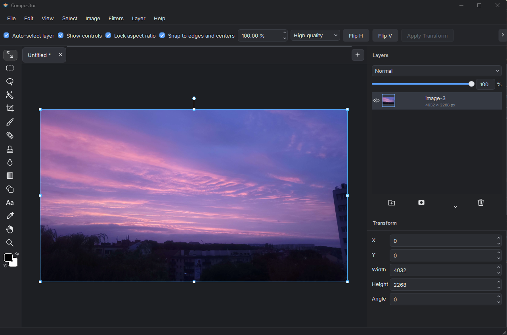
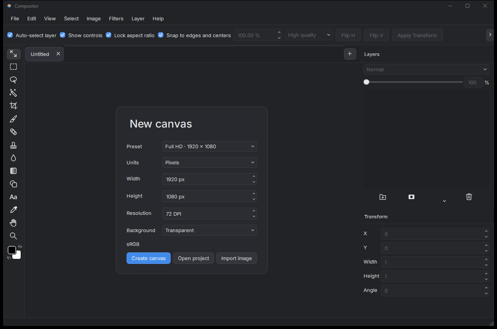
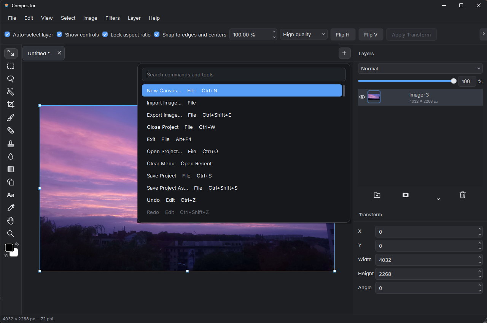

# Compositor for Windows

A picture is a stack of decisions. Where the subject sits. What stays sharp. What disappears into the background.

Compositor is the image editor [Robbie Tilton](https://robbietilton.com/compositor) built for the Mac. This is the Windows 11 version of that editor: layers, masks, selections, paint, adjustments, filters, and background removal that runs on your machine.



We wanted the same compositing workflow on Windows, with the window, the file dialogs, and the shortcuts you already use. The canvas, the layer stack, and the project you save should still feel like Compositor.

Windows title bars and system buttons are the default. If you prefer the colored controls on the left, turn on **View → Appearance → Mac-style title bar**. That choice is saved. It changes the window frame, and the rest of the editor stays as it is.

## Open it and make something

**[Download the latest release](https://github.com/Cengokill/CompositorWindows/releases)** · **[User guide](docs/user-guide.md)** · **[Try the demo](demo/README.md)** · **[Report an issue](https://github.com/Cengokill/CompositorWindows/issues)**

**What you get**

- An **x64 MSI**, or a **portable ZIP**. In the ZIP, run `Compositor.exe`.
- Windows 11 x64. The runtime libraries and the foreground-removal model are already in the package. There is no account, and there is no model download on first launch.
- Unsigned builds. Windows can show an unknown-publisher warning. Compositor checks GitHub once a day for a newer stable release and links to its page, and you install the update yourself. You can turn the check off in **Help → Check for Updates…**.



## What's new in 1.1.0

Version 1.1.0 is the first build that reports its release number, and it moves the packages to the stable channel. The [release notes](docs/release-notes.md) list everything. The main additions:

- **Start and navigate.** New canvas presets with print units and backgrounds, **File → Open Recent**, a command palette (**Ctrl+Shift+P**), a navigator mini-map, rulers and guides, a layout grid with snap targets, and canvas-only full screen (**F11**).
- **Customize.** A keyboard shortcut editor in **Help → Keyboard Shortcuts**, and a daily check for new stable releases.
- **Edit.** 90° canvas rotation, **Filters → Last Filter** (**Ctrl+Alt+F**), Color Balance and Black & White controls, restyled Camera Raw sliders with double-click reset, and RAW development before import (see below).
- **Photoshop files.** Editable PSD shapes, 16-bit RGB layers kept at 16 bits, and cropping of oversized or off-canvas layers.
- **Save and export.** Background project saving, and one-page PDF export at the document's print size, next to PNG and JPEG.

**RAW files open in RAW Development first.** Set exposure, temperature, tint and noise reduction with a live preview before the photo becomes a layer.


The command palette (**Ctrl+Shift+P**) finds every command and tool by name.



A project is a `.comp` folder. Copy or back up the whole folder. **File → Import Image**, the Save step of **Export Image**, and the first **Save Project** open Windows Explorer. **File → Open Project** and the welcome **Open project** button open the Windows folder picker in Downloads, and you can select one or more `.comp` folders. Export a flattened PNG, JPEG or one-page PDF when another application needs a single image.

This build has [known limitations](KNOWN-ISSUES.md). A large soft brush can pause. Hair, fur, and transparent subjects can need a pass with the mask tools. Exchanging a project with the Mac app, and matching the Mac app pixel for pixel, are still unverified. Keep a copy of the complete `.comp` folder when you try that.

## Robbie made Compositor

The editing ideas, the design, and the original application came from Robbie. This port exists because he made Compositor and released the source. His work is the foundation, and it is still the reference we follow.

**[Original source](https://github.com/robbietilton/Compositor)** · **[Compositor for Mac](https://robbietilton.com/compositor)** · **[Robbie on X](https://x.com/robbietilton)**

The Windows effort was started and directed by **[IAmTheBlurr](https://github.com/IAmTheBlurr)**, and most of the implementation was done with agentic AI using Codex. We maintain it independently. Robbie has not endorsed this port. The original copyright and MIT notices stay in the tree.

## Staying with the original

We want this editor to stay in step with Robbie's Compositor: the core tools, the editing behavior, the design, and the project format. A Windows improvement is welcome when it fits that foundation.

The dependency pin is Mac Compositor **1.0.4**, at [`a19db90`](https://github.com/robbietilton/Compositor/tree/a19db9011282399785dc18efcfded904627bdcc2). The port follows the observable behavior from that baseline through 1.4.5 where it applies on Windows, including later blend modes, folder opacity, guides, finishing adjustments and filters, CPU layer effects, DirectWrite text, line shapes, and PSD, SVG, and RAW import. The pin stays at `a19db90` until a project written by the Mac 1.4.5 tree has been read here. Windows version numbers are independent of the Mac app's.

## Have at it

Fork it. Fix the thing that annoyed you. Make something beautiful. Try the weird idea.

Small fixes and large experiments both belong here. Open an issue, send a PR, or take a fork somewhere we did not expect. Tell us what changed and how you checked it. **PRs are welcome. Merging depends on fit.** The changes we are happiest to take are the ones that keep the core and make the Windows editor better. A useful discovery may also belong in the original project.

The short version of working on the code is in [contributing](CONTRIBUTING.md).

## Build it yourself

Use Windows 11 x64, PowerShell 7, Visual Studio 2022 C++ tools, Windows SDK 10.0.26100.0, and Python 3.12 for the first model conversion. Dependency inputs are pinned. For the locked codec binaries, keep an extracted copy of the matching portable download.

```powershell
. ./scripts/bootstrap.ps1 -Python C:\Python312\python.exe -RuntimeDirectory C:\Extracted\CompositorWindows
cmake --preset windows-x64-release
cmake --build --preset windows-x64-release --target Compositor --parallel 4
```

The [build instructions](docs/source-package.md) cover runtime assets and tests. The [documentation index](docs/README.md) groups the tutorial, the how-to guides, the reference, and the explanation. The same pages are for people and for coding agents. The code is the authority for how a behavior is implemented. The docs explain how to use it, and the decisions that need context.

## License and credits

Application source is [MIT licensed](LICENSE), retaining **Copyright (c) 2026 Wonder Assembly LLC**. Qt, the image codecs, ONNX Runtime, the model weights, and the Inter font have their own licenses and notices in `dependencies/` and `assets/`. Downloads include the applicable notices and the corresponding sources. Demo artwork and photography have [separate credits](demo/README.md#image-permissions).

If a brush, a mask, or a project file does something you did not expect, [tell us](https://github.com/Cengokill/CompositorWindows/issues), with the version and the steps.
