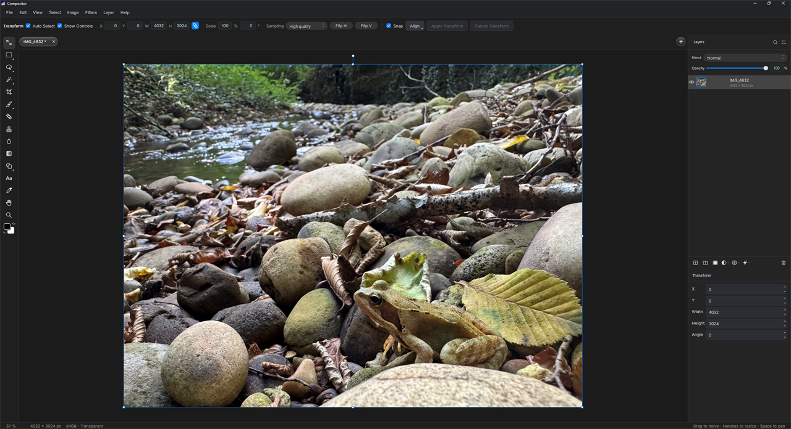
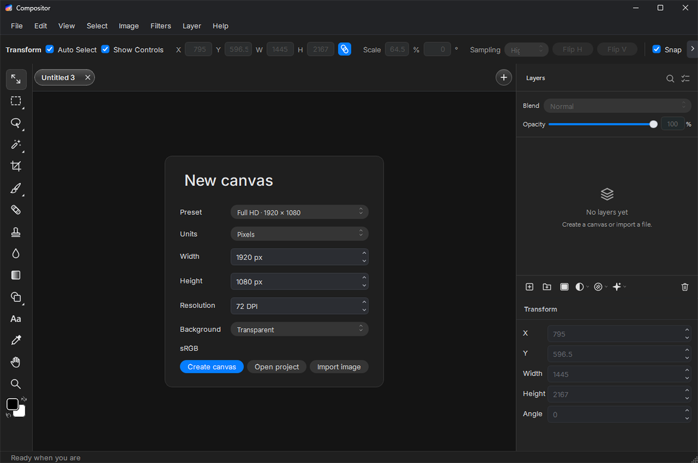

# Compositor for Windows

A picture is a stack of decisions. Where the subject sits. What stays sharp. What disappears into the background.

Compositor is the image editor [Robbie Tilton](https://robbietilton.com/compositor) built for the Mac. This is the Windows 11 version of that editor: layers, masks, selections, paint, adjustments, filters, and background removal that runs on your machine.



We wanted the same compositing workflow on Windows, with the window, the file dialogs, and the shortcuts you already use. The canvas, the layer stack, and the project you save should still feel like Compositor.

Windows title bars and system buttons are the default. If you prefer the colored controls on the left, turn on **View → Appearance → Mac-style title bar**. That choice is saved. It changes the window frame, and the rest of the editor stays as it is.

## Open it and make something

**[Download the latest release](https://github.com/Cengokill/CompositorWindows/releases)** · **[User guide](docs/user-guide.md)** · **[Try the demo](demo/README.md)** · **[Report an issue](https://github.com/Cengokill/CompositorWindows/issues)**

Install the setup EXE or the x64 MSI, or extract the portable ZIP and run `Compositor.exe`. Then choose **File → New Canvas** or **File → Import Image**, or drop an image on the window. The [demo](demo/README.md) walks through a complete edit, from import to export.



## What's new in 1.6.0

See the [release notes](docs/release-notes.md) for details.

- **Layers and selections.** See the drop position as you drag layers in the redesigned panel. Feather a selection from the tool options bar.
- **JPEG and PNG export.** Choose Standard, Optimized or Progressive JPEG. Interlace a PNG or fill transparent pixels with a background color.
- **Faster editing.** Zoom through deep layer stacks more smoothly. Blur, Smudge and Liquify start faster on 8-bit layers, and Camera Raw updates Texture previews sooner.
- **Alignment and effects.** Snap a layer to the canvas center with the grid hidden. Preview, apply and export Lens Effects on SDR photos up to 8 million pixels at full resolution.

## Features

The [user guide](docs/user-guide.md) describes each workflow and its limits.

### Layers

- Layers and folders, with opacity and blend modes. A folder's opacity dims everything inside it.
- Layer masks, clipping stacks, and adjustment layers that stay editable, including Vignette, Tonal Contrast, Lens Effects, Sharpen, Progressive Blur, Bloom / Glow and RGB Split.
- Layer effects: Drop Shadow, Inner Shadow, Outer Glow, Inner Glow, Stroke and Color Overlay.
- Duplicate, rename, reorder and nest layers by drag and drop, with a drop indicator that shows where the layer lands. Search the list or show only the selected layers.
- Merge, group, ungroup and duplicate layers, with Align and Distribute.

### Transform

- Move, scale, rotate and flip layers without losing source pixels, with exact values for position, size, scale and angle.
- Free distortion, with an Apply and Cancel step.
- Snapping to the canvas, layer edges and centers, guides and a layout grid. Rulers and draggable guides.
- Rotate the whole canvas by 90°, change the canvas or image size, and crop with ratios and a custom ratio.

### Selections

- Rectangle and Ellipse Marquee, Freehand and Polygonal Lasso, Magic Wand and Object selection.
- Add to or subtract from a selection. Expand, Contract and Feather it.
- Move a selection outline, or move and duplicate the pixels inside it.

### Painting and retouching

- Brush and Eraser with size, hardness and opacity, and pen pressure for a graphics tablet.
- Clone Stamp, Spot Healing, Liquify, Blur and Smudge.
- Gradient, Shape and Line tools that stay editable.
- Type tool with live, editable text, paragraph boxes, and mixed fonts and colors.
- Eyedropper, foreground and background colors, and the Windows color dialog.

### Adjustments and filters

- Levels, Curves, Hue/Saturation, Exposure, Gradient Map, Grain, Black & White, Color Balance and Invert, as destructive edits or as adjustment layers.
- Camera Raw filter, Gaussian and Motion Blur, Progressive Blur, Sharpen, noise, Vignette, Bloom, Tonal Contrast, Lens Effects, Rim Light, Volumetric Light (with Extract Depth), Lens Correction, Dither and Scanlines.
- Remove Background, which runs offline on your machine.
- Live previews with Apply and Cancel. **Filters → Last Filter** (**Ctrl+Alt+F**) repeats the last filter with the same settings.

### Canvas and files

- Several projects at once, each in its own tab.
- A project is a `.comp` folder. Copy or back up the whole folder. **File → Open Project** can open several folders at a time.
- Import PNG, JPEG, TIFF, HEIC, PDF (one layer per page), animated GIF, camera RAW with a development step, SVG, EXR and Radiance HDR, and Photoshop PSD and PSB.
- Export PNG, JPEG, TIFF, PDF, animated GIF and OpenEXR, with a live preview of the size. Channel Pack writes layers into the red, green, blue and alpha channels of a PNG.
- Focus Stack combines photos taken at different focus distances.
- CMYK profiles, with Proof Colors and CMYK export.
- Canvas-only full screen (**F11**), a navigator minimap when the view is zoomed, and a pixel grid at high zoom.
- Keyboard shortcuts that you can remap in **Help → Keyboard Shortcuts**.

This build has [known limitations](KNOWN-ISSUES.md). A large soft brush can pause. Hair, fur, and transparent subjects can need a pass with the mask tools. Exchanging a project with the Mac app, and matching the Mac app pixel for pixel, are still unverified. Keep a copy of the complete `.comp` folder when you try that.

## Requirements

- Windows 11 x64.
- No account, no administrator rights, and no model download on first launch. The runtime libraries and the foreground-removal model are in the package.
- The builds are unsigned, so Windows can show an unknown-publisher warning. Compositor checks GitHub for a newer stable release at startup and periodically while open, and links to its page for manual installation. You can turn the check off in **Help → Check for Updates…**.
- To build from source: PowerShell 7, Visual Studio 2022 C++ tools, Windows SDK 10.0.26100.0, and Python 3.12 for the first model conversion.

## Building

Dependency inputs are pinned. For the locked codec binaries, keep an extracted copy of the matching portable download.

```powershell
. ./scripts/bootstrap.ps1 -Python C:\Python312\python.exe -RuntimeDirectory C:\Extracted\CompositorWindows
cmake --preset windows-x64-release
cmake --build --preset windows-x64-release --target Compositor --parallel 4
```

The [build instructions](docs/source-package.md) cover runtime assets and tests. The [documentation index](docs/README.md) groups the tutorial, the how-to guides, the reference, and the explanation. The same pages are for people and for coding agents. The code is the authority for how a behavior is implemented. The docs explain how to use it, and the decisions that need context.

## Releasing

Each release adds a `# Compositor Windows X.Y.Z` entry to [`docs/release-notes.md`](docs/release-notes.md), matching the version in `CMakeLists.txt`. The in-app **What's New** window shows that entry.

`scripts/package.ps1` then builds the Release executable and writes a new `dist/CompositorWindows-<version>-<timestamp>` folder. It holds the setup EXE, the MSI, the portable ZIP, the source ZIP, the demo ZIP, the SHA256 sums, and a manifest that records the Git revision. `tests/packaging/run_checks.ps1` checks the package. The packages are unsigned and published by hand on the GitHub releases page. [Packaging](docs/packaging.md) has the full procedure and its requirements.

## Robbie made Compositor

The editing ideas, the design, and the original application came from Robbie. This port exists because he made Compositor and released the source. His work is the foundation, and it is still the reference we follow.

**[Original source](https://github.com/robbietilton/Compositor)** · **[Compositor for Mac](https://robbietilton.com/compositor)** · **[Robbie on X](https://x.com/robbietilton)**

The Windows effort was started and directed by **[IAmTheBlurr](https://github.com/IAmTheBlurr)**, and most of the implementation was done with agentic AI using Codex. We maintain it independently. Robbie has not endorsed this port. The original copyright and MIT notices stay in the tree.

## Staying with the original

We want this editor to stay in step with Robbie's Compositor: the core tools, the editing behavior, the design, and the project format. A Windows improvement is welcome when it fits that foundation.

The dependency pin is Mac Compositor **1.0.4**, at [`a19db90`](https://github.com/robbietilton/Compositor/tree/a19db9011282399785dc18efcfded904627bdcc2). The port follows the observable behavior from that baseline through 1.4.5 where it applies on Windows, including later blend modes, folder opacity, guides, finishing adjustments and filters, CPU layer effects, DirectWrite text, line shapes, and PSD, SVG, and RAW import. The pin stays at `a19db90` until a project written by the Mac 1.4.5 tree has been read here. Windows version numbers are independent of the Mac app's.

## Have at it

Fork it. Fix the thing that annoyed you. Make something beautiful. Try the weird idea.

Small fixes and large experiments both belong here. Open an issue, send a PR, or take a fork somewhere we did not expect. Tell us what changed and how you checked it. **PRs are welcome. Merging depends on fit.** The changes we are happiest to take are the ones that keep the core and make the Windows editor better. A useful discovery may also belong in the original project.

The short version of working on the code is in [contributing](CONTRIBUTING.md).

## License

Application source is [MIT licensed](LICENSE), retaining **Copyright (c) 2026 Wonder Assembly LLC**. Qt, the image codecs, ONNX Runtime, the model weights, and the Inter font have their own licenses and notices in `dependencies/` and `assets/`. Downloads include the applicable notices and the corresponding sources. Demo artwork and photography have [separate credits](demo/README.md#image-permissions).

This software is based in part on the work of the Independent JPEG Group.

If a brush, a mask, or a project file does something you did not expect, [tell us](https://github.com/Cengokill/CompositorWindows/issues), with the version and the steps.
