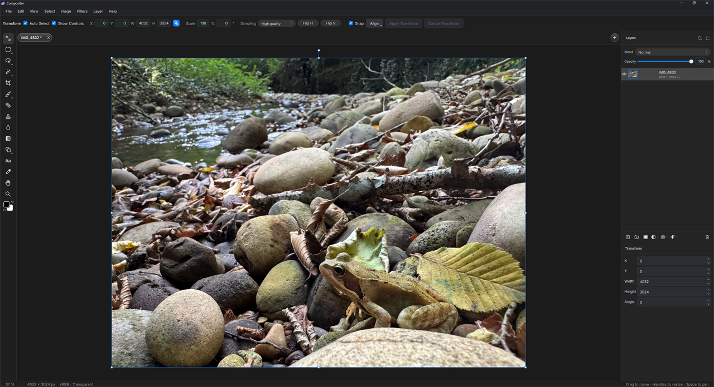
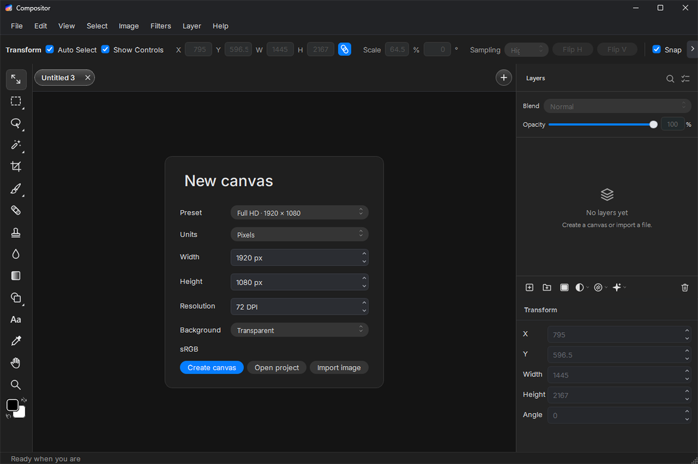
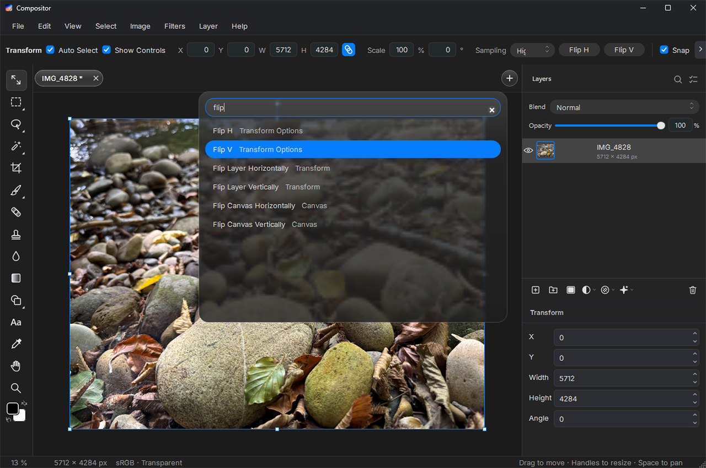

<div align="center">

# Compositor Windows 汉化版 · 开源免费图片编辑器

**面向 Windows 11 的图像合成与修图工作台 —— 图层、蒙版、选区、绘画、调色、滤镜与离线抠图，界面全中文。**

本仓库是 [Cengokill/CompositorWindows](https://github.com/Cengokill/CompositorWindows) 的**简体中文汉化分支**。上游是 [Robbie Tilton](https://robbietilton.com/compositor) 在 macOS 上开发的 Compositor 的 Windows 移植版；本分支在保持原有编辑行为、项目格式与快捷键的前提下，把界面文案完整本地化为中文，并直接编译出可运行的 `exe`。

[](LICENSE)
[](#系统要求)
[](#版本说明)
[](#汉化说明)
[](https://github.com/Cengokill/CompositorWindows)

</div>

---

> [!IMPORTANT]
> **关于本仓库的定位**
> 1. **这是汉化分支，不是官方版本。** 代码来自上游 `Cengokill/CompositorWindows`（MIT 协议）。原始编辑逻辑、设计版权归 Robbie Tilton / Wonder Assembly LLC；Windows 移植由上游维护者独立维护。本分支仅追加中文界面层，**不代表上游或原作者的任何背书**。
> 2. **汉化只作用于显示层。** 菜单标题、命令 ID、快捷键配置项、`.comp` 项目格式全部保持英文原文与原有取值——这样做是为了让快捷键、命令面板、项目文件与上游完全兼容，不会因为你用中文版而出现配置错乱或项目互不识别。
> 3. **构建是未签名的。** 自行编译产出的 `exe` 没有代码签名，Windows 可能提示"未知发布者"，属正常现象。

---

## 📖 目录

- [这是什么](#这是什么)
- [汉化说明](#汉化说明)
- [核心特性](#核心特性)
- [界面与工作流](#界面与工作流)
- [系统要求](#系统要求)
- [快速开始](#快速开始)
  - [一、直接运行预编译版本](#一直接运行预编译版本)
  - [二、从源码构建](#二从源码构建)
  - [三、汉化文件的维护与更新](#三汉化文件的维护与更新)
- [项目结构](#项目结构)
- [版本说明](#版本说明)
- [已知限制](#已知限制)
- [常见问题](#常见问题)
- [上游与致谢](#上游与致谢)
- [开源协议](#开源协议)

---

## 💡 这是什么

Photoshop 太贵，GIMP 的交互又很难让人保持"心流"。Compositor 就是为此而生的一个免费、开源的完整图像编辑器，围绕**合成与后期**的工作流设计：图层栈、蒙版、选区、绘画、调色、滤镜、抠图，一步到位地做出最终成片。

原版 Compositor 只在 macOS 上运行。`CompositorWindows` 把它原生移植到了 Windows 11：

- 使用 **C++20 + Qt 6 Widgets + Direct3D 11** 重写，不是套壳，也不是 Electron；
- 保留 `.comp` 可编辑项目格式（一个文件夹，里面是清单与图层资源）；
- 使用 Windows 的窗口、文件对话框与快捷键习惯，同时保留原版 macOS 风格的窗口外观可选项；
- **抠图（Remove Background）完全离线在本机推理**，模型随安装包分发，首次启动不下载、不需要账号。

**汉化分支额外做的事**：把整套界面文案翻译成简体中文，并把翻译编译进程序内部——因此你拿到的 `exe` 复制到任何机器上都是中文的，不依赖外部语言文件。

---

## 🔤 汉化说明

汉化采用 **Qt 官方翻译机制**，而不是"改源码里的字符串"这种一次性做法。技术上分三步：

| 环节 | 做法 | 文件 |
|---|---|---|
| **显示层翻译** | 界面控件的可见文本经 `localizedText()` 输出中文，但控件内部仍以英文原文作为命令键 | [src/ui/LocalizedText.cpp](src/ui/LocalizedText.cpp) |
| **翻译词条** | 以 Qt `.ts`（XML）维护全部词条，可审阅、可 diff、可增量补充 | [i18n/compositor_zh_CN.ts](i18n/compositor_zh_CN.ts) |
| **编译期嵌入** | `.ts` 经 `lrelease` 编译为 `.qm`，再由 Qt 资源系统打进 `Compositor.exe` | [i18n/compositor_zh_CN.qm](i18n/compositor_zh_CN.qm) |

**为什么不做字符串硬替换？** 因为上游有三处逻辑依赖英文原文：

1. **命令目录**（`CommandRegistry.cpp`）用成对的英文 `menu` + `label` 查表定位命令，例如 `commandSpec("File","New Canvas…")`；
2. **菜单排序**（`VisualStyle.cpp`）用英文标题 `findMenu("View")` 重新排列菜单；
3. **快捷键偏好**按稳定的命令 ID 存储，并在英文标签的 ` (Ctrl+X)` 后缀上做重算。

一旦把这些英文直接改成中文，快捷键、命令面板、菜单顺序会同时失效。所以本分支的做法是——**英文原文永远保留为"键"，中文只负责"显示"**。

**已汉化范围**：

- 全部菜单标题与菜单项（文件 / 编辑 / 图像 / 图层 / 选择 / 滤镜 / 视图 / 帮助等）；
- 命令面板（`Ctrl+Shift+P`）的条目名称，且**支持中文与英文双语搜索**；
- 面板、对话框、工具提示与状态提示中的界面文案；
- 标题栏外观选项、更新提示、导出与导入过程中的进度提示等。

**未翻译的内容**（有意保留）：

- 命令行参数、日志输出、错误码等面向开发者的文本；
- `CMYK`、`HDR`、`EXR`、`PSD`、`ONNX` 等专有名词与技术缩写；
- 图层名、项目名等**你自己创建**的数据；
- 帮助文档（`docs/` 下的 Markdown）仍为英文。

---

## ✨ 核心特性

（以下能力均来自上游 1.6.0，汉化分支未删减任何功能。）

| 特性 | 说明 |
|---|---|
| 🗂 **图层与组** | 图层、图层组、不透明度与混合模式；组的透明度作用于组内全部内容；拖拽即可重排、嵌套、复制、重命名，下落位置有实时指示 |
| 🎭 **蒙版与剪贴** | 图层蒙版、剪贴蒙版、可反复编辑的调整图层（晕影、色调对比、镜头效果、锐化、渐进模糊、泛光、RGB 分离等） |
| 💫 **图层效果** | 投影、内阴影、外发光、内发光、描边、颜色叠加 |
| 🖌 **绘画与修饰** | 画笔与橡皮（可调大小、硬度、不透明度，支持数位板压感）、仿制图章、污点修复、液化、模糊、涂抹；渐变、形状、直线保持可编辑 |
| ✍️ **文字** | 实时可编辑文字、段落文本框、混合字体与颜色 |
| 🎯 **选区** | 矩形/椭圆选框、自由套索与多边形套索、魔棒、对象选择；加选/减选、扩展/收缩/羽化；整体移动选区或移动复制选区内容 |
| 🔄 **变换** | 移动、缩放、旋转、翻转而不损失源像素，可输入精确数值；自由变形支持"应用/取消"两步确认；可吸附到画布、图层边缘与中心、参考线与版式网格 |
| 🎨 **调色与滤镜** | 色阶、曲线、色相/饱和度、曝光、渐变映射、颗粒、黑白、色彩平衡、反相；高斯/动感模糊、渐进模糊、锐化、噪点、晕影、泛光、色调对比、镜头效果、轮廓光、镜头校正、抖动、扫描线；`Ctrl+Alt+F` 可重复上一次滤镜 |
| ✂️ **离线抠图** | 移除背景在本机 CPU 推理，模型随包分发，不需联网、不需账号 |
| 🖼 **画布与文件** | 多项目标签页；`.comp` 文件夹即项目（整目录复制即备份）；导入 PNG/JPEG/TIFF/HEIC/PDF/GIF/相机 RAW/SVG/EXR/Radiance HDR/PSD/PSB；导出 PNG/JPEG/TIFF/PDF/GIF/OpenEXR |
| 🧩 **焦点堆栈** | 把不同对焦距离拍摄的多张照片合成为一张全景深照片 |
| 🖨 **CMYK** | 支持 CMYK 配置文件、校样颜色与 CMYK 导出 |
| ⌨️ **快捷键** | 全部快捷键可在"帮助 → 键盘快捷键"中重新映射 |

---

## 🖥 界面与工作流

编辑器由三部分构成：左侧工具栏、中间画布、右侧图层面板。



新建画布时可选择预设、打印单位、分辨率与背景：



命令面板（`Ctrl+Shift+P`）可直接检索所有命令，汉化后支持中文关键字：



窗口外观是**原生 Windows 标题栏**（默认），也可以在 **视图 → 外观 → macOS 风格标题栏** 切换为左侧彩色窗口按钮，该选择会被记住。

---

## ⚙️ 系统要求

| 项目 | 要求 |
|---|---|
| 操作系统 | Windows 11 x64 |
| 图形 | 支持 Direct3D 11 的显卡（软件回退也可运行） |
| 权限 | 无需管理员权限、无需账号 |
| 联网 | 运行与抠图**不需要**联网；仅启动时的"检查更新"会访问 GitHub |
| 源码构建 | PowerShell、Visual Studio 2022 C++ 工具、Windows SDK 10.0.26100.0、Python 3.12 |

---

## 🚀 快速开始

### 一、直接运行预编译版本

1. 解压便携版压缩包（或安装 `setup.exe` / `x64 MSI`）；
2. 运行 `Compositor.exe`；
3. 选择 **文件 → 新建画布**，或 **文件 → 导入图片**，也可以直接把图片拖进窗口；
4. 想跟着完整流程走一遍，可打开仓库中的 `demo` 示例项目。

> 便携版是"绿色"的：整个目录复制到别的电脑即可使用，配置与最近项目记录保存在系统用户目录下。

### 二、从源码构建

依赖版本全部锁定（Qt 6.8.3、libjpeg-turbo 3.2.1、OpenEXR 3.3.5、ONNX Runtime 1.30.0 等），首次构建需要联网下载。

```powershell
# 1. 准备依赖（下载并校验 Qt、编译 libheif/LibRaw、转换抠图模型）
. ./scripts/bootstrap.ps1 -Python C:\Python312\python.exe

# 2. 配置与编译
cmake --preset windows-x64-release
cmake --build --preset windows-x64-release --target Compositor --parallel 4

# 3. 产物位置
#    build\release\Release\Compositor.exe
```

打包为安装包 / 便携包 / MSI：

```powershell
./scripts/package.ps1
# 输出到 dist\CompositorWindows-<版本>-<时间戳>\
```

> **构建路径提示**：本仓库的 CMake 脚本使用 `file(SHA256 ...)` 校验依赖，而 **CMake 在处理含中文的路径时会异常退出**。请把仓库放在纯英文路径下构建（例如 `E:\compositor-build\src`），否则会在配置阶段崩溃。

### 三、汉化文件的维护与更新

修改或新增中文词条时，只需要编辑 `.ts` 文件并重新编译，**不必改动任何 C++ 代码**：

```powershell
# 编辑 i18n/compositor_zh_CN.ts 后，用 Qt 的 lrelease 重新生成 .qm
lrelease i18n/compositor_zh_CN.ts -qm i18n/compositor_zh_CN.qm

# 然后正常重新编译，.qm 会被自动打进 exe
cmake --build --preset windows-x64-release --target Compositor --parallel 4
```

需要批量从源码重新提取待翻译字符串时，可用 Qt 的 `lupdate`：

```powershell
lupdate src -ts i18n/compositor_zh_CN.ts
```

---

## 📂 项目结构

```text
.
├── README.md                        # 本文件（汉化分支说明）
├── CMakeLists.txt                   # 构建定义，含翻译资源登记
├── CMakePresets.json                # windows-x64-release / debug / asan 预设
├── i18n/                            # 汉化分支新增
│   ├── compositor_zh_CN.ts          # 中文词条（Qt Linguist XML，可审阅）
│   └── compositor_zh_CN.qm          # 编译后的词条，构建时嵌入 exe
├── src/
│   ├── main.cpp                     # 入口：创建应用后装载中文翻译器
│   ├── ui/
│   │   ├── LocalizedText.h/.cpp     # 汉化分支新增：显示层翻译与菜单标题本地化
│   │   ├── CommandRegistry.cpp      # 命令目录；检索同时匹配中英文
│   │   ├── CommandPalette.cpp       # 命令面板；条目显示中文
│   │   ├── MainWindow.cpp           # 菜单构建；显示中文、保留英文命令键
│   │   └── VisualStyle.cpp          # 菜单排序后再统一本地化标题
│   ├── core/                        # 文档、图层、缓存
│   ├── editing/                     # 选区、变换、像素编辑
│   ├── graphics/                    # 像素算法、D3D11 笔刷
│   ├── effects/ effects_tools/      # 调整与滤镜
│   ├── imaging/                     # 编解码、PSD/RAW/PDF/GIF、ONNX 抠图
│   ├── persistence/                 # .comp 项目读写
│   └── text/                        # 文字排版
├── docs/                            # 用户指南、架构、打包、项目格式（英文）
├── demo/                            # 完整示例项目
├── scripts/                         # bootstrap / package / 校验脚本
└── tests/                           # CTest 测试套件
```

---

## 🧭 版本说明

| 项目 | 值 |
|---|---|
| 应用版本 | **1.6.0** |
| 汉化词条数 | 192 条（覆盖菜单、命令面板、面板与提示） |
| 上游基线 | Mac Compositor `1.0.4`（`a19db90`）起，行为对齐至 1.4.5 在 Windows 上的可观察部分 |
| 项目格式 | 可读写 `.comp` 版本 1–13，写出能表示当前文档的最低版本 |

上游 1.6.0 的主要变化：重做界面外观（统一强调色与 Liquid Glass 下拉菜单）、图层面板拖拽落点指示、JPEG/PNG 导出选项、深层图层栈缩放更流畅、镜头效果预览与导出等。详见 [docs/release-notes.md](docs/release-notes.md)。

---

## ⚠️ 已知限制

以下限制继承自上游，汉化未改变任何行为：

| 方面 | 限制 |
|---|---|
| 性能 | 超大柔性笔刷在 4000px 文档上可能卡顿（p95 延迟约 40ms 量级，最差起笔/收笔可达数百毫秒） |
| 抠图质量 | 发丝、绒毛、半透明物体可能残留背景色，建议配合蒙版工具二次修整 |
| HDR | HDR 画布以 SDR 呈现；部分破坏性操作需先显式转 16 位 |
| 导入 | CMYK 的 PSD 需要 ICC 配置文件；SVG 导入后被栅格化；PSD/PSB 的 CMYK 文字与矢量层会被栅格化 |
| Mac 互通 | 与 Mac 版项目的双向交换、逐像素对齐**尚未验证**；尝试时请备份完整 `.comp` 文件夹 |
| 签名 | 构建未签名，Windows 可能提示未知发布者 |

完整清单见 [KNOWN-ISSUES.md](KNOWN-ISSUES.md)。

---

## ❓ 常见问题

1. **为什么菜单里有的地方还是英文？**
   界面文案已整体汉化，但专有名词（CMYK、HDR、EXR、ONNX 等）、日志与开发者提示、以及帮助文档保持英文。如果你发现某个**纯界面文案**仍是英文，欢迎提交 issue 指出具体位置。

2. **中文版能打开别人用英文版做的 `.comp` 项目吗？**
   可以。汉化只改显示文本，项目格式、图层 ID 与文件结构完全没有变化，双向都能打开。

3. **重映射快捷键会出错吗？**
   不会。快捷键按稳定的英文命令 ID 存储，与界面显示语言无关，中文界面下改键同样有效。

4. **构建时 CMake 直接崩溃（退出码 `0xC0000409`）怎么办？**
   这是 CMake 处理含中文路径时的已知问题。请把仓库放到纯英文路径（如 `E:\compositor-build\src`）再配置。

5. **首次启动需要下载模型吗？**
   不需要。抠图模型（BiRefNet-lite 的 ONNX 版本）随安装包分发，全程离线推理。

6. **这个汉化版会跟上游同步吗？**
   本分支基于上游 1.6.0。上游更新后，汉化词条需要针对新增文案补充；`.ts` 是纯文本，合并冲突通常很小。

---

## 🙏 上游与致谢

- **原始创意、设计与 macOS 版**：[Robbie Tilton](https://robbietilton.com/compositor) ／ [Compositor 源码](https://github.com/robbietilton/Compositor)。本项目的一切建立在原作者开源的基础上。
- **Windows 原生移植**：[Cengokill/CompositorWindows](https://github.com/Cengokill/CompositorWindows)，由 [IAmTheBlurr](https://github.com/IAmTheBlurr) 发起并主导，实现大量借助 Codex 完成。
- **本汉化分支**：在上游基础上追加中文界面层，未改动编辑行为。

---

## 📄 开源协议

应用源码遵循 **[MIT License](LICENSE)**，保留 **Copyright (c) 2026 Wonder Assembly LLC**。

Qt、图像编解码库、ONNX Runtime、模型权重与 Inter 字体各有其独立许可，声明位于 `dependencies/` 与 `assets/`。演示素材与摄影作品另有署名说明。

本软件部分基于 Independent JPEG Group 的工作。
