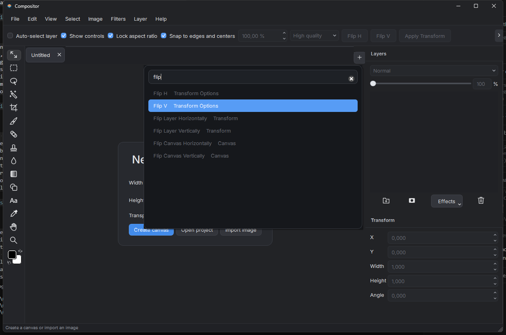

# Using Compositor on Windows

This Windows 11 x64 preview opens and edits layered images locally. It is an independent port of Compositor 1.0.4 by Robbie Tilton, based on upstream commit `a19db9011282399785dc18efcfded904627bdcc2`. See the release notes for supported workflows and measured limitations.

## Start a project

In an installed build, use the Start menu shortcut. In a portable build, open `Compositor.exe`. Choose **File > New Canvas** to enter canvas dimensions, or **File > Import Image** to import a PNG, JPEG, TIFF or HEIC image. The welcome **Import image** button and **File > Import Image** both open the Windows file explorer, starting in Downloads. The selected file is added to the project that was active when that picker opened, even if another tab is current when the dialog closes. Each project has its own tab, layer selection and tool settings. The Layers panel selects the image or mask you are editing.

Import a PDF through **File > Import Image** or drop it on the workspace. Each page becomes an image layer, with page 1 at the top. Text and vectors become pixels, and unpainted areas stay transparent. A new canvas takes the first page's dimensions at 72 DPI. In an existing document, pages are rasterized at its resolution and scaled down in the layer transform if needed to fit the canvas. **Ctrl+Z** removes all pages from the import together. An unreadable PDF adds no layers, and the other selected files can still import. Cancel during PDF preparation discards the entire selection. If the file requires a password, save an unlocked copy first.

Import an animated GIF through **File > Import Image** or by dropping it onto the workspace. Select its layer to show **GIF frames** beneath the canvas. Each thumbnail shows its frame number and delay in milliseconds. Select a frame to edit its pixels, use **Play** to preview, **Duplicate** or **Delete** to change the sequence, and **Frame delay** to change the selected frame's timing. Frame edits, duplication, deletion and timing changes can be undone and redone. Save the project to keep the animation editable. In **File > Export Image**, choose **GIF** to export the composite animation. If several GIF layers are present, the selected animated layer determines the exported duration; otherwise the first animated layer does. Other animated layers loop during that duration. GIF export reduces colors to a 216-color palette and transparency to fully transparent or opaque pixels; output loops continuously. Imported delays are kept in hundredths of a second; playback treats a zero delay as 20 ms. GIF layers count all their frames against the project image budget, so large animations may be rejected. Windows animated projects use a Windows-specific format extension; exchange with Mac animated projects is not supported.

Camera RAW files (`.cr2`, `.nef`, `.arw`, `.dng`, `.raw`, `.rw2`) open a RAW Development dialog before they are added, from the welcome button, **File > Import Image**, or a drop. Exposure, Temperature (K), Tint and Noise reduction start at the file's as-shot values and the preview shows the developed result. Move a slider to change that setting; a double-click restores it to the as-shot value. Import adds the developed image as a 16-bit sRGB layer. **Camera Raw…** imports the image and opens the Camera Raw Filter on the new layer. One image per batch can use this action; later images can still be imported normally. If another edit panel is open, finish or cancel it to let the queued import start and open Camera Raw. Cancel in that filter discards the filter adjustments but keeps the imported layer; use Undo to remove the import. Cancel in RAW Development adds nothing from that file or from the rest of the batch. The original RAW file is not changed and is not stored in the project. Lens correction is unavailable because the LibRaw decoder applies no lens profile. Temperature and tint are estimated from the camera colour matrix and are not calibrated against a colour target; noise reduction is a wavelet threshold whose strength scale is not calibrated either. Preview and import use the same development path.

**File > Focus Stack Images…** combines 2 to 16 photos of the same subject taken at different focus distances. Select the images in the file explorer; when a document is open, choose **New Layer** to add the result to it as one undoable "Focus Stack" step, or **New Document** to open it in a new tab. Every image must have the same pixel dimensions as the first; an unreadable or differently sized file shows an error and changes nothing. The first image is the reference. The others are aligned by a whole-pixel shift of up to 5% of the image size; rotation and the magnification change of focus breathing are not corrected. Each output pixel is copied from the image with the highest local contrast at that point, unless the two sharpest images score about equally there; then the pixel is the average of every image covering it, which avoids a noisy patchwork in flat areas. Cancel in the progress window discards the result. The source files are not changed, and the result is an ordinary image layer saved in the `.comp` project and included in exports. The stack must fit the 1.2 GB estimated working-memory budget, which allows about five 24-megapixel images.

The New Canvas card starts at 1920 × 1080 pixels with a transparent background. Choose a preset or edit a dimension to use Custom. Presets are grouped as Photo (4 × 6, 5 × 7 and 8 × 10 in, landscape and portrait), Print (Letter, Legal, Tabloid, A4 and A3), Art & Illustration (Poster 18 × 24 in and Postcard 4 × 6 in), Web (1366 × 768, 1440 × 900, Full HD 1920 × 1080, Square and Vertical HD) and Film & Video (HD and 4K UHD). Print presets use 300 DPI and Web presets use 72 DPI. Units can be pixels, inches, centimeters, or millimeters. Print sizes are converted to whole pixels at the Resolution (1–9,600 DPI): for example, 8.5 × 11 in at 300 DPI is 2550 × 3300 px. Changing units keeps the pixel size, and changing the resolution keeps the pixel size and changes the printed size. Either change switches a preset to Custom, because the preset's printed size no longer applies. Background can be Transparent, which creates an empty **Layer 1**, or White or Black, which creates an opaque **Background** layer. A White or Black canvas larger than 100 megapixels is refused; a transparent canvas has no such limit at creation. Undo removes the new canvas and returns to the welcome card.

Use **File > Open Project** or the welcome **Open project** button for a saved `.comp` project. Both open the Windows file explorer in Downloads and allow one or more `.comp` folders to be selected. A `.comp` project is a directory containing its manifest and image assets. Copy or back up the complete directory. The first **Save Project** and **Save Project As** open the Windows file explorer. An untitled save starts in Downloads. **Save Project As** for a project that already has a path starts in that project's folder when the folder still exists. Save with **Ctrl+S** after a path is chosen. An asterisk in the tab indicates unsaved changes. Closing a modified project offers Save, Discard or Cancel. If a file picker is already open, the status bar reports "A file picker is already open" and the new request is ignored.

**File > Open Recent** lists up to 10 `.comp` folders that were opened or saved successfully, most recent first. Choosing one opens it like **Open Project**; a project that is already open is selected instead of opened twice. Folders on a local drive that were moved or deleted are removed from the list when the menu is shown. Projects on a network share, a mapped or removable drive, or a drive that is not connected stay listed, so opening the menu never waits for them; choosing one that is unavailable reports an error and keeps the current project. **Clear Menu** empties the list and is disabled when it is empty. The list is kept between sessions.

## Window appearance

Windows title bars and system controls are the default. Turn on **View > Appearance > Mac-style title bar** for colored controls on the left; turn it off to restore the native Windows title bar. The choice applies immediately to the editor and dialogs and is remembered between launches. It changes only the window chrome; the editor's visual design stays the same.

**View > Canvas-Only Full Screen** (F11) fills the screen with the canvas on black and hides the menu bar, project tabs, toolbars, panels, and status bar. Press F11 or Escape to leave. The window returns to its previous normal or maximized state, and the panels, focus, and active project are restored. Entering and leaving do not change the document, selection, or undo history. Escape leaves this mode before it reaches the canvas, so a pending crop, gradient, or transform preview stays in place for Apply or Cancel. Menu shortcuts such as Ctrl+Z still work in this mode. The mode cannot be entered or left while a canvas drag is held.

## Navigate and arrange layers

Use **Ctrl+0** to fit the canvas and **Ctrl+1** for actual pixels. Hold **Space** and drag to pan. The mouse wheel pans, including with Ctrl. Alt and roll the wheel forward to zoom in, or backward to zoom out, around the pointer. One notch multiplies or divides the zoom by 1.25. Pixel Grid is available in the View menu and appears at high zoom. When zoom or pan leaves part of the image off-screen, a navigator appears at the bottom-right of the canvas. It shows the whole document and a rectangle for the visible area. Click or drag inside it to move the view. The picture updates shortly after editing pauses, including after a brush stroke finishes, rather than on every step of the stroke.

Use **Search** in the Layers header to find layer names, and **Selected** to show the current selection. The controls can be combined. Matching layers and folders are shown with their parent folders for context; other contents of a matching folder remain hidden. turning the filters off restores the previous folder expansion. Search and filtering do not change the project or its visible pixels. While filtering, dragging a selection with hidden layers and dropping into empty space are disabled; clear the filters to use those operations. In the search field, Escape clears the text, then closes the field when it is empty.

Hold the middle mouse button (press the wheel) and drag in the Layers panel to scroll the list. The list follows the pointer without selecting or editing layers, including over thumbnails and visibility controls. Release the button, even outside the panel, to stop; switching windows also ends the gesture.

Select a layer in the Layers panel. Use its visibility control to hide or show it, and the blend and opacity controls to change its appearance. The Layer menu contains duplication, grouping, ordering, clipping and merge operations. A mask thumbnail selects mask editing; select the image thumbnail to return to the image. A live text layer uses an Aa glyph in place of the image thumbnail, with the subtitle Text. A mask thumbnail on that row is unchanged, and the Type tool uses the same Aa glyph. Mask operations are in the Mask menu. Painting white reveals coverage and painting black hides it.

The **Move** tool moves selected layers. Transform handles scale and rotate them. The Transform panel accepts numeric position, size, and angle, and shows those values without trailing zeros; a typed value still keeps three decimal places. Ordinary layer transforms preserve source pixels. A free-distortion draft has Apply and Cancel actions and resamples on Apply. **Escape** cancels an active operation; **Ctrl+Z** undoes a committed change.

## Select, paint and draw

Marquee, Lasso, Polygon and Wand create selections. Shift adds and Alt subtracts. Polygon closes when you click near its first point, double-click, or press Enter; Backspace removes its most recent corner. With a selection tool active in New selection mode, dragging inside a selection moves its outline. With a selection tool active, Ctrl-drag moves selected image pixels; Ctrl+Alt-drag duplicates them. Arrow keys move by one pixel and Shift+arrow by ten.

Brush and Eraser use the current tip controls. Turn on **Pressure** next to **Size**, **Opacity**, or both to use a pen tablet. A lighter touch narrows the tip or reduces its strength, up to the values set in the toolbar. A mouse or trackpad paints at the selected size and opacity. Clone, Heal and Retouch expose their own options in the upper toolbar. Select a mask before using the same painting tools to edit coverage. The Foreground and Background controls open the color palette; **X** swaps them and **D** restores defaults. Editing is disabled when the target is hidden, incompatible with the tool, or waiting for another operation.

Gradient keeps a pending preview until Apply. Cancel or Escape discards it. Shape creates rectangles, ellipses, and lines with editable style. Shift+U switches the shape kind. For a rectangle with a positive corner radius, turn on **Smooth Corners** in the Drawing Options bar to soften the transition from the straight edge into each corner. Smoothing decreases as the radius approaches half the shorter side. Stroke adds an outline inside the shape's bounds, with its width and colour set in the same bar. With a shape layer selected, changing its kind, radius, smoothing, or stroke is undoable. Consecutive width or radius steps form one edit. Crop has an explicit Apply action. Image and Canvas commands change the image dimensions, canvas bounds or resolution; check the selected anchor and units before applying.

Each project remembers its Freehand/Polygonal lasso choice and separate Expand/Contract amounts. **L** returns to the remembered lasso kind. Crop offers Free, Original, 1:1, 4:3, 3:4, 16:9, and 9:16. When a selection exists, a new crop starts from that selection. The middle mouse button pans the canvas. Horizontal and vertical rulers stay at the edges of the canvas and show document pixels. View → Rulers (Ctrl+R) shows or hides them for the session. A new session starts with them hidden, and hiding them returns that margin to the canvas. The numbers stay aligned with the image at fit, at actual pixels, and after zooming or panning. Drag from the top ruler to add a horizontal guide, or from the left ruler to add a vertical guide. Drag a guide to move it; its position is shown while the pointer moves. Releasing the pointer commits one undo step. Escape cancels the drag. Releasing a new guide back on its ruler, or releasing a guide outside the document on its axis, also cancels it and leaves the document unchanged. View → Guides shows or hides guides and adds one at the vertical center when the document has none. Opening a project shows the guides saved in it.

**View → Layout Grid** shows or hides a layout grid over the canvas. It is separate from Pixel Grid and is never part of exported pixels. **View → Grid Settings…** sets the major spacing in document pixels, the number of subdivisions, the color, and the opacity; Cancel discards the changes. The grid starts hidden in each project. Its spacing, subdivisions, color, and opacity are remembered for new projects.

**View → Snap** is the master switch for snapping; the Snap to edges and centers check box in the transform options bar stays in sync with it. **View → Snap To** chooses the targets: Grid, Guides, Layer Edges, Layer Centers, Document Edges, and Document Center. Each target can be enabled independently, and Grid snaps to every grid line, major and minor. Moving layers and groups, cropping, rectangular and elliptical marquees, moving a selection, drawing rectangles, ellipses, and lines, and placing polygonal lasso vertices all snap to the enabled targets. Hold Ctrl to suppress snapping for a single gesture. Shift keeps its constraint, so a snapped move never leaves the locked axis. Freehand lasso, brush, and wand are not snapped. Each completed edit is one undo step.

## Adjust an image

Image > Adjustments and the Filters menu provide color and tonal adjustments, blur, noise, lens correction, the Camera Raw Filter, content-aware fill, vignette, bloom, tonal contrast, dither, scanlines, Progressive Blur, and RGB Split. Select an image layer first; a selection restricts applicable pixel edits. 16-bit layers keep their retained samples for fill, invert, brush, clone, blur, smudge, liquify, most filters, Camera Raw light/color/curves/geometry, and adjustments. Spot Healing, Lens Correction, Content-Aware Fill, and Camera Raw mixer/grading/effects/detail/optics ask to convert to 8-bit first; Cancel leaves the document unchanged. Gaussian, Motion, Progressive Blur, and RGB Split keep a layer's edge pixels along any side that sits on the canvas. A vignette can cover an empty layer. Inspect the preview, then Apply to commit one undoable change or Cancel to discard it. Adjustment-layer commands keep editable adjustment parameters in the layer stack, including Invert, Black and White, Color Balance, blur or noise layers, Progressive Blur, Bloom / Glow, and RGB Split. Double-click a slider to restore its default value.

Image > Rotate 90° Clockwise and Image > Rotate 90° Counterclockwise turn the whole document. The canvas width and height swap, and layers, masks, guides, shadow angles, and the active selection turn with it. Each rotation is one undoable step. A rotation is refused, with the document unchanged, when a layer would be placed beyond ±1,000,000 units from the origin; move that layer closer to the canvas first.

Layer effects (drop shadow, inner shadow, outer and inner glow, stroke, and color overlay) are stored on the layer and rendered on the CPU. Color Overlay recolors the fill inside the layer's existing alpha, so a translucent pixel keeps that coverage in the overlay color. Inner Shadow and Inner Glow still composite over the fill. Hidden effects keep their settings. The Effects menu in the Layers panel footer adds one of those effects. Its dialog previews the change; Cancel restores the layer and OK commits one undo step without discarding live text. Type (T), or Layer → Text Layer…, starts point text at a click. Dragging the Type tool at least 4 pixels creates a paragraph box: the text wraps inside it, and the corner and edge handles move or resize that box without scaling the type. The minimum side is 16 pixels. The first handle drag on point text turns it into a box at its current size. With the Move tool, double-click live text to edit it. Drag across the letters, or Shift-click, to highlight a range; double-click a word to highlight that word. Ctrl+Left and Ctrl+Right move by word, and Ctrl+Shift extends that selection. Alt+Left and Alt+Right change tracking; Alt+Up and Alt+Down change leading, and Shift multiplies the step by ten. Leading left at Auto uses 120% of the font size. Escape discards the edit. Ctrl+Enter, Done, or another tool commits it as one undo step, New Text Layer or Edit Text. The type bar sets the font, style, size, alignment, tracking, leading, and color of the selection, or of the whole text when the caret has no selection. A selection that mixes fonts or styles shows Multiple in both controls. Open the font picker from the Type bar with a click or Space. Search by family, style, or both in the field above the list. Hover a face or use the arrow keys to preview it, then click or press Enter to choose it. Escape clears the search first and then closes the picker. Clicking outside or closing without choosing restores the previous face. When a project refers to a font that is missing on this PC, the bar still shows the saved family and style. The color button previews on the canvas; Cancel restores the color from when the picker opened, and OK commits one typing step. After the font menu, size field, or color picker closes, typing continues on the canvas, and the pointer stays visible. Several colors and faces in one layer are saved as text runs. A later destructive pixel edit flattens the text. Layer → Duplicate Layer (Ctrl+Shift+J) copies the layer, including its text, mask, and effects. J remains Spot Healing and Ctrl+J remains Layer via Copy. Layer → Ungroup promotes the folder's children. Help → Keyboard Shortcuts lists the catalogued shortcuts. Tab, with the wand active and no modifier, switches between color and object selection. Object selection needs the bundled BiRefNet model.

Filter dialogs reopen the choices last used with Apply, including Curves, Exposure, Grain and background-removal controls. Cancel preserves the previously remembered choices, and each project keeps its own values. A new Gradient Map always starts from the current foreground and background colors. Live adjustment layers retain their own parameters. After you apply a filter from the **Filters** menu, **Filters > Last Filter** (Ctrl+Alt+F) runs that filter again on the current layer or selection with the same settings, without reopening the panel, as one undo step. The menu item is labeled with the remembered filter name. Image-menu adjustments and Content-Aware Fill do not become Last Filter. A progress dialog can cancel Last Filter; closing the project or window cancels an in-flight repeat and waits for it to stop. Filter Apply allows up to 4 GB of transient working memory (enough for a 100-megapixel Apply), which is separate from the 1.2 GB import and merge caps.

**Filters > Progressive Blur** varies the blur from one end of a line to the other. Drag on the canvas to place the line, set **From** and **To** in pixels, choose **Radial** for a circular transition, or turn on **Invert** to swap the ends. The preview uses a reduced image; Apply renders the full layer and can take longer on large images. The blur can extend beyond the layer boundary. Its working-memory needs can limit the maximum image size below the general filter limit.

**Filters > RGB Split** separates colors along an angle or spreads them out from a center in **Radial** mode. Click or drag on the canvas to move the radial center. **Blur** adds a streak along the direction of the split. Convert HDR layers to 16-bit before running the filter. The same kernel is available as an editable **RGB Split** adjustment layer.

**Split to Layers** creates four opaque grayscale layers from the source pixels. Red, Green, Blue, and Alpha start hidden so the canvas looks the same. Show a layer to inspect its channel. The source keeps its pixels, mask and effects. Fully transparent source pixels have no recoverable RGB. For a 16-bit source, confirm creation of 8-bit channel layers while the source retains its precision. Undo removes all four layers in one step. A typical camera RAW such as 6720 × 4480 can be split: each image raster stays within 100 million pixels, and the combined project image budget is 500 million pixels so the source plus four channel copies of a full-size layer can be saved. If other image layers already fill that combined budget, the filter explains why the split cannot proceed.

**Adjustments > Bloom / Glow** is the amount/radius glow used by adjustment layers. **Filters > Bloom** keeps the existing Windows strength/threshold bloom. Convert HDR layers before either bloom path.

Progressive Blur, Bloom / Glow, and RGB Split adjustment layers require project format v16 or later. Reciprocal Mac exchange of version 16 has not been verified.

**Filters > Camera Raw Filter** replaces the pixels of the active image layer. It is not an adjustment layer and it is not stored in the project. The panel docks to the right edge of the document window. The preview uses the layer’s native pixel grid as you adjust the sliders. The last completed preview stays visible while the next grade renders. For layers or settings that exceed the filter’s working memory budget, the panel shows a reduced preview and returns to native resolution when the budget allows it. OK commits one undo step named Camera Raw Filter at full resolution and remembers that grade until the project closes; an unchanged grade adds no undo. Cancel leaves both the pixels and the remembered grade unchanged. Hold Alt while dragging Exposure, Highlights, or Whites to preview highlight clipping, while dragging Shadows or Blacks to preview shadow clipping, and while dragging Masking to preview the sharpening mask. The white-balance, point-color, and defringe droppers, and guided upright lines, are sampled on the canvas. There is no camera profile or kelvin preset. Guided Upright follows the drawn lines rather than a vanishing-point fit. Those guide lines stay visible on the preview, aligned with the image while zooming or panning, until Clear Guides or the filter closes.

Remove Background runs the bundled model offline. Basic uses its initial mask; Advanced exposes refinement, edge shift and contrast. Applying creates or updates an undoable layer mask. Inspect fine edges before accepting the result. Fine hair and fur can retain source-background colors, and transparent objects such as soap bubbles can lose their appearance. Advanced refinement is not always an improvement. A no-subject result leaves the image unchanged; textured backgrounds can be ambiguous. Use the mask painting tools for cleanup.

## Export and exchange files

Choose **File > Export Image** for PNG, JPEG, TIFF or PDF. PNG and RGB TIFF retain transparency. TIFF uses lossless LZW compression. JPEG uses the selected matte and quality. PDF writes the flattened document on one page, losslessly (Flate, not JPEG). The page is the document size divided by its resolution, so a 3000 × 2000 px document at 300 DPI is a 10 × 6.67 in page; the dialog shows the page size and pixel size. **Scale** (25, 50, 75, 100 or 200 %) resamples the image and shrinks or grows the printed page, keeping the DPI. **Background** fills transparent pixels, and the preview shows both settings. Some PDF viewers refuse pages larger than about 200 in, which a very large canvas at a low DPI can exceed. At a scale other than 100 %, the whole canvas is held in memory while it is resampled. Wait for the encoded preview to finish; Save opens the Windows file explorer in Downloads to choose the destination, then writes those prepared bytes. A JPEG destination whose name ends in `.png` is written as `.jpg`, a PDF destination is written as `.pdf`, and a PNG destination whose name ends in `.jpg` or `.jpeg` is written as `.png`. A name that already has the matching extension is kept, and the extension is not appended a second time. Cancel in the export panel or in the explorer leaves an existing destination unchanged. Export supports at most 30,000 pixels on either side and 100 million pixels in total; larger editing canvases can require resizing before export.

Project Save preserves layers, masks and editable metadata. Export creates a flattened image for other applications. Copy/Cut use the selected target, Copy Merged uses the visible composite, and Paste inserts clipboard image pixels.

The Windows reader implements project versions 1–17 and writes the lowest version that can represent the document. Paragraph alignment, tracking, leading, a text box, and a non-regular font style are version 12; a shape stroke is version 14; Progressive Blur, Bloom / Glow, and RGB Split adjustment layers require version 16. Saving a rectangle with Smooth Corners enabled writes version 17, including when the project was opened from an older format. Actual Mac-generated compatibility fixtures have not yet been supplied. Keep an original copy when testing project exchange with the Mac application. 8-bit and 16-bit RGB PSD and PSB files can import simple horizontal type as editable text, including family, size, color, and alignment. A solid-colour rectangle, rounded rectangle with one uniform corner radius, or ellipse becomes an editable shape when its path matches Photoshop's shape bounds; its position is rounded to whole-pixel size once. A solid, opaque, undashed stroke on such a shape becomes an editable stroke: centred and outside strokes grow the shape bounds to hold the outer edge, inside strokes keep the bounds, and the width is read as document pixels. Gradient fills, dashed, translucent, or non-solid strokes, unequal corner radii, rotated or compound paths, and shapes larger than the supported budget stay as pixels when cached pixels exist, and PSD import then lists them in a warning with Continue and Cancel. Cancel imports nothing from that file. 16-bit RGB channels stay 16-bit in the project. PNG export stays 16-bit for root layers that are not clipped and have no adjustment or effect. A folder, clipping mask, adjustment, or effect exports the same 8-bit composite as the canvas. A gradient, fill, invert, clear, brush, clone, blur, smudge, liquify, most filters, Camera Raw light/color/curves/geometry, and destructive or live adjustments on a 16-bit layer keep the extra precision. Spot Healing, Lens Correction, Content-Aware Fill, Camera Raw mixer/grading/effects/detail/optics, Split to Layers, and retouch on a canvas of 25 million pixels or more ask to convert the layer to 8-bit first; Cancel leaves the document unchanged. JPEG export is 8-bit. Layer records stored in the 16-bit `Lr16` block are imported with their names, stacking order, visibility, and canvas positions. ZIP-compressed channels and layer masks are kept. A rounded-rectangle shape layer is rasterized from its fill and stroke. Editable type keeps the Photoshop pixel rendition, so the imported composite stays in place. Editing that type keeps each style run's installed font; only a missing face is drawn with Segoe UI, and the edited glyphs stay on the imported ink. Done without a change restores the Photoshop pixels. If layer records cannot be decoded, the merged composite is imported instead. When the stored font name is an installed PostScript name, import uses the matching DirectWrite family. A font that is not installed is drawn with Segoe UI. Full justification becomes left alignment. Vertical type, and type this editor cannot store, is imported as pixels. 8-bit and 16-bit CMYK PSD/PSB files use the embedded ICC profile to convert ink channels into the existing RGB working layers. Black ink, layer alpha and masks are separate. CMYK type and vector layers remain cached pixels; extra spot-color and saved-selection channels are not retained. Malformed CMYK channels are rejected; their omission is not silently accepted. There is no PSD or PSB export.

### CMYK profiles and proof colors

Choose **View > CMYK > Load Profile…** to attach a CMYK output ICC/ICM profile. The change is undoable and the profile is copied into the `.comp` package (format version 15). Loading the same profile again creates no edit. The last explicitly loaded profile is also remembered as the source fallback for files without an embedded profile; embedded profiles take precedence. ICC files must be valid CMYK output profiles, at most 16 MiB, supporting conversion in both directions.

**View > CMYK > Proof Colors** previews the RGB composite through that profile, on white paper, before the monitor display conversion. It leaves working pixels, history and RGB exports unchanged. The toggle belongs to the tab and starts off on reopen; the profile survives save/reopen. Guides, selections and other editing overlays stay outside the proof transform. The navigator remains RGB. Preparation runs in the background; a canvas tooltip reports preparation or failure. Proofing uses an interpolated 33 × 33 × 33 lookup, so its preview can differ slightly from exact export conversion. It is not a calibrated print or paper simulation.

CMYK JPEG/TIFF and CMYK PSD/PSB imports require an embedded profile or the fallback you selected. If neither is available, choose the source profile when prompted. Cancel stops before tab creation or pending-edit commits. Missing-profile review covers a complete selected or dropped batch before its first import. CMYK Photoshop imports retain converted 16-bit RGB data for 16-bit sources, with the same editing limitations as RGB imports. In addition to the existing 100-million-pixel project limits, estimated simultaneous CMYK decode planes and retained RGB/mask buffers must fit the existing 1.2 GB import working budget. This estimate excludes the encoded PSD buffer and codec internals; peak process memory has not been measured.

For JPEG, TIFF or PDF export, select **Color mode: CMYK** and choose an output profile (initially the document profile). Export flattens transparency over **Background**, converts to 8-bit CMYK, and embeds the exact ICC profile. TIFF and PDF retain those CMYK samples losslessly; JPEG uses the chosen quality. PNG stays RGB. Choosing an export-only profile does not edit the document or change the import fallback. The encoded preview and Save use the same prepared file. The canvas proof uses white, so select a white export background when comparing them. ICC conversion uses relative colorimetric intent; black-point compensation and custom rendering intents are not exposed.

## Common shortcuts

Shortcuts apply to the editor when a text field or dialog is not using the keys.

| Action | Shortcut |
|---|---|
| New / Open / Save | Ctrl+N / Ctrl+O / Ctrl+S |
| Save As / Export | Ctrl+Shift+S / Ctrl+Shift+E |
| Close project | Ctrl+W |
| Undo / Redo | Ctrl+Z / Ctrl+Shift+Z |
| Cut / Copy / Paste | Ctrl+X / Ctrl+C / Ctrl+V |
| Fit / Actual pixels | Ctrl+0 / Ctrl+1 |
| Canvas-only full screen (enter / leave) | F11 / F11 or Escape |
| Move / Hand | V / H |
| Marquee / Lasso / Wand | M / L / W |
| Brush / Eraser | B / E |
| Clone / Heal / Retouch | S / J / R |
| Gradient / Shape / Crop | G / U / C |
| Eyedropper / Zoom | I / Z |
| Temporary pan | Hold Space and drag |
| Foreground/background swap / defaults | X / D |
| Last Filter | Ctrl+Alt+F |
| Command Palette | Ctrl+Shift+P |
| Cancel a pending gesture | Escape |

Help → Command Palette… opens the same search. It lists currently bound commands and tools. Arrow keys move the highlight, and Enter runs the selected command.

To change a shortcut, choose **Help > Keyboard Shortcuts**. Select a command, then press a key combination in **Shortcut**, or in **Alternate** for a second binding such as Redo's Ctrl+Y. **Clear** removes the command's shortcuts. A key assigned to two commands is listed below the table, and **Save** stays unavailable until you change or clear one of them. Escape, Tab, Enter, Space, the digits, the bracket keys, the arrow keys, and Delete and Backspace (alone or with Alt, Ctrl, or Shift, except Content-Aware Fill's Shift+Delete) stay reserved for canvas editing. **Save** applies the shortcuts and keeps them for later sessions; **Cancel** discards your changes. **Restore Defaults** returns every command to its original shortcuts; then choose **Save**. Text fields keep their usual typing and editing keys, and changing shortcuts does not affect project files or undo history.

Menu items show additional shortcuts and current availability. Updates are manual: install the next MSI, or extract the next portable download into a separate folder. Keep projects outside the application folder and back up each complete `.comp` directory. Compositor does not download or install updates itself. About 10 seconds after launch, and then once a day while it stays open, it asks GitHub for the latest stable CompositorWindows release (any `vX.Y.Z` release not marked draft or prerelease). This is one network request a day; nothing about your projects is sent. When a newer version exists, a notice offers **Download…** (opens the release page in your browser), **Skip This Version** or **Later**. Your open projects are not touched. Network errors are silent and the check is retried the next day. Turn the check off with **Check for new stable releases automatically** in **Help > Check for Updates…**, where **Check for New Release** also runs it on demand. The notice only points to the GitHub release page: Compositor does not verify the downloaded package, which is unsigned.

## HDR images and OpenEXR

Import `.exr` or `.hdr` through Import Image, the welcome screen, startup file arguments, or a file drop. EXR accepts a single RGB/RGBA image (HALF or FLOAT channels, scanline or tiled level zero) in linear sRGB/Rec.709. Deep, multipart, subsampled, extra-channel and other-primary EXR files are rejected. Radiance accepts RGBE images in the decoder's standard `-Y +X` orientation. The data window becomes the imported image grid; EXR display-window placement is not imported.

The layer subtitle shows **HDR**. The retained pixels are extended-sRGB half floats; the canvas and thumbnails show an SDR copy, clipped at white. This does not enable an HDR monitor mode. All EXR/HDR imports retain the floating representation, including files whose values fit within white. Non-finite values, invalid alpha and values outside the working half-float range are rejected.

Use **Adjustments > Exposure** to bring highlights into view: a four-times-white linear value becomes twice white at −1 EV, and white at −2 EV. Levels, Curves and color adjustments retain HDR; bounded color operators normalize each pixel's highlight range and restore its scale. Gaussian/Motion Blur operate on floating pixels. Supported Camera Raw color controls use this normalized path, with Exposure applied in linear light. Preview, Apply and Last Filter use the retained HDR source.

Normalized color operators and layer effects reuse the existing 8-bit kernels, so they can quantize colors or clip negative components even though highlight scale is retained. Layer effects are an approximation in HDR. Smooth HDR transforms currently use bilinear sampling without the SDR mip cache; strong downscaling can alias. This is not full upstream rendering parity.

Painting/erasing, fill, gradients, resizing and layer merges retain HDR. Retouching, selected-pixel transforms, Lens Correction, Content-Aware Fill, Bloom, Bloom / Glow, RGB Split, Tonal Contrast, Scanlines, and spatial Camera Raw corrections require conversion first. **Layer > Convert HDR to 16-Bit…** asks before clipping highlights/negative colors and creates one undo step. Cancel leaves the layer unchanged; Undo restores its HDR pixels. Copying image pixels to the system clipboard remains an SDR operation.

Save Project stores HDR layers as EXR assets in `.comp` format v13 or later; masks remain PNG. A stroked shape still requires v14. Existing Windows builds that only understand PNG project assets cannot open these HDR projects. Mac exchange is unverified.

Choose **OpenEXR** in Export Image to retain highlights in a flattened, ZIP-compressed scene-linear FLOAT RGBA file. The preview is SDR; JPEG quality, matte and PDF scale do not apply. PNG, JPEG and PDF export HDR documents as SDR. Cancelling HDR preflight, an edit preview, or EXR encoding does not install its prepared result. Export replaces an existing destination only after encoding succeeds. Working-memory checks can reject a large HDR decode, padded filter, or merge before its buffers are allocated.
